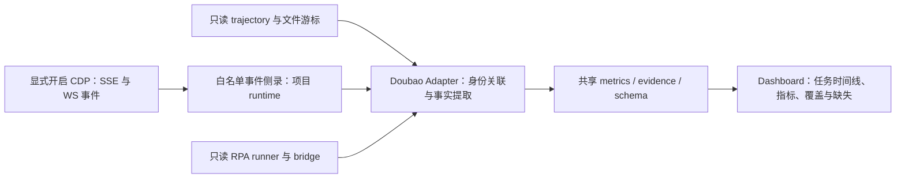

# 豆包工作 App：日志观测参考与指标扩展建议

后续实现已落地，口径与验证边界见 [Doubao 观测增强 v0.3](doubao-observation-v0.3.md)。下文“当前代码”及本机样本描述的是实施前的研究快照。

研究日期：2026-10-13（Asia/Shanghai）。本文件是源码研究与实施建议，不代表新增指标已经实现或客户端采集已经通过验收。

## 1. 结论

豆包工作可以优先补充**工具执行完整性、首文本延迟、任务状态、人工等待、RPA 执行与采集覆盖**。这些指标主要依靠轨迹配对和实时事件，不必先解决 Token usage。

当前指标少有两类原因：源本身没有提供 Token/内部模型执行数据；已有采集器与适配器尚未充分提取、正确关联和区分观测语义。应先校准现有口径，再扩大采集范围。

三个参考项目分别提供快照展示、任务执行状态管理、桌面 UI 读取方法，没有证据表明它们能直接获得豆包工作内部全部模型调用的 Token/成本。额外找到的 OpenAssistant 提供 SSE 流实时读取的具体实现，参考价值较高。

## 2. 核对范围与证据

| 对象 | 核对版本 | 证据边界 |
|---|---|---|
| 本项目 | 工作区当前文件；HEAD `cb86d63541d2284c049798d74fbf91641fb0cb2a` | 阅读 AGENTS/SPEC/README、豆包适配器、采集器、共享读取/指标/归一化代码 |
| doubao-task-monitor | `13d9ef6d8e8548d077ded52380fae083a2d45dbf` | 仓库文件树、指针、进度与分钟快照；没有采集端源码 |
| doubao-studio | `7eeb7b67a518e47ee4296c36e5c5f17942a9cff0` | Core、IPC、任务/账号 Store、错误/额度规则、接口脱敏投影、领域模型 |
| opencli 当前 | `0f8fd4470793e141e7df2146a2008dbbca830db8` | 当前树及桌面适配器删除历史 |
| opencli 桌面历史 | `24136945847afbfad266c6c46a8cd335377f9112` | 删除前的 doubao-app helpers、ask、read、dump、文档 |
| OpenAssistant | `81c70654a6b400b33e2160f5a95947f2472a827a` | 豆包桌面 adapter 的 SSE fetch 包装与 DOM polling |

还只读检查了项目内现存 `runtime/collectors/doubao/`：1 个 attempt 文件、4 条记录，4 条 `first_output_source=derived`，均有请求结束时间；usage、模型、context_window、tool_calls、human_confirm 等字段没有有效值。这只是现存小样本，不能代表全部任务或当前客户端版本的能力。

对默认 CDP 端口 9223 的 `/json/version` 只读检查返回 `ECONNREFUSED`，因此本次没有验证实时 SSE/WS/DOM 路径。没有启动客户端、发送测试消息、注入脚本、安装外部项目或修改 Agent 原始数据。公开参考源仅下载到忽略提交的项目内 `runtime/research/`，没有新增启动依赖。原有工作区修改保留。

## 3. 三个项目怎样监控

### 3.1 doubao-task-monitor：轨迹摘要的快照发布

公开仓库只有 README、`progress.json`、`index.json`、`data/` 和 `snap/` JSON。进度快照包含任务名称、状态、累计记录/调用/返回计数、更新时间和简化步骤；没有开源解析器、守护进程或完整前端。快照文字提到 trajectory、沙箱、Python/nginx 和刷新回退，属于发布者的任务叙述，不能当成可复现源码。

可确认的公开链路是：**某个未开源采集端 → JSON 快照 → GitHub 文件 → 展示端刷新**。快照叙述的三级回退是 GitHub API 列目录、分钟路径探测、索引兜底；本次无法核验其实际刷新代码，也不将当时叙述的 CDN 缓存时长推广为今天的通用规则。

`total_steps` 不能直接理解为“预先规划的总步骤”。没有 planned_total、完成步骤定义或计算代码；计数与 `steps` 摘要数组长度也不同。`last_update` 与 `pushed_at` 分别反映数据更新/发布时间，均不能回填每个内部步骤的发生时间。`waiting` 是发布者提供的状态，来源和状态机未公开。

对本项目有价值的是：展示最近事件、调用/返回配对、数据更新时间、快照 revision 和 stale 状态。GitHub 推送不是新增原始证据的方式；本项目可使用本机 API/SSE，并保留字段白名单，避免发布 Prompt、回复和工具正文。

来源：[进度样本](https://github.com/Leon7261/doubao-task-monitor/blob/13d9ef6d8e8548d077ded52380fae083a2d45dbf/progress.json)、[分钟快照](https://github.com/Leon7261/doubao-task-monitor/blob/13d9ef6d8e8548d077ded52380fae083a2d45dbf/snap/latest-20260921-1206.json)。未发现 LICENSE 文件；适合作为设计参考，不能据此认定源码可直接复制分发。

### 3.2 doubao-studio：因为自己执行任务，所以拥有运行边界

这是社区开发的 Electron 豆包网页生产工作台，主要面向图片/视频生产；与本项目观测的官方豆包工作 App 不是同一软件。它的指标丰富来自**自己负责调度、提交、等待、恢复与下载**，并非读到了官方桌面 Agent 的完整内部日志。

实际源码有以下边界：

| 层 | 机制 | 获得的观测事实 |
|---|---|---|
| 执行层 | 页面控件回读、受理证据、产物观察、执行回调 | 当前阶段、等待确认、平台是否受理、产物发现 |
| 任务持久化 | `TaskService.updateRuntime()` 写运行快照；`TaskRepository` 统一写 `tasks.json` | runId、attempt、startedAt、stageStartedAt、lastHeartbeatAt、submittedAt、终态 |
| 运行历史 | 按 runId 维护 `runHistory`，最近 20 次 | 终态、错误码、finishedAt、durationMs |
| 任务事件 | Repository 写成功后发布状态/阶段/产物变更 | eventId、sequence、timestamp、taskId；进程内最多 2000 条，非跨重启持久事件日志 |
| 日志中心 | IPC 追加 `logs.json`，最近 5000 条 | info/warn/error、scope、taskId/accountId、createdAt；UI 分级和关键词筛选 |
| 崩溃日志 | 主进程追加 `crash.log`，超过 2 MiB 保留尾部 512 KiB | 异常与拒绝诊断；与任务日志分开 |
| 兼容诊断 | 页面规则检查、版本化规则包与回退 | 可见控件能力；最近 50 份 adapter 报告 |
| 对外接口 | 显式 `--local-control` 的 loopback HTTP，及 CLI/MCP | 白名单任务/账号/产物快照；控制动作另有审计 |

`TaskRunSnapshot` 还有 `acceptanceObservation`、观察租约、页面准备耗时、上传计数与耗时、素材授权 detected/clicked/verified 等结构。这说明“模型之外的用户可见流程”也能提供实用指标。但它只保留当前阶段快照和运行历史，不能仅凭最新 stageStartedAt 还原所有历史阶段时长；完整阶段耗时仍需要持续保留转移事件。

错误类型有一部分通过消息正则分类，属于规则推断；本项目应保留 `unknown`，区分平台结构化错误与候选归因。依赖阻断从平台生成失败率中排除的做法可以借鉴。

Seedance 每日 6 单位、每 5 秒 1 单位是该项目代码中的预测规则，不是本次核验的官方额度规则，更不能用来反推豆包工作 Token、Credits 或费用。

还要区分**磁盘完整数据与公开接口投影**：`LocalControlServer.sanitizeTask()` 仅提供 status/stage/attempt/errorCode/outputCount/createdAt/updatedAt 等，未暴露完整 runId、运行历史和阶段时间。若将来可选接入 Studio，它应有单独身份/语义，不并入官方 Doubao Adapter；只读 API 接入也不能承诺获得磁盘模型里的全部指标。

来源：[任务服务](https://github.com/dorakoo/doubao-studio/blob/7eeb7b67a518e47ee4296c36e5c5f17942a9cff0/main/core/TaskService.ts)、[任务事件流](https://github.com/dorakoo/doubao-studio/blob/7eeb7b67a518e47ee4296c36e5c5f17942a9cff0/main/core/TaskEventStream.ts)、[领域模型](https://github.com/dorakoo/doubao-studio/blob/7eeb7b67a518e47ee4296c36e5c5f17942a9cff0/packages/contracts/src/domain.ts)、[日志 IPC](https://github.com/dorakoo/doubao-studio/blob/7eeb7b67a518e47ee4296c36e5c5f17942a9cff0/main/ipc/system.ts)、[诊断与报告](https://github.com/dorakoo/doubao-studio/blob/7eeb7b67a518e47ee4296c36e5c5f17942a9cff0/main/ipc/tasks.ts)、[接口投影](https://github.com/dorakoo/doubao-studio/blob/7eeb7b67a518e47ee4296c36e5c5f17942a9cff0/main/control/LocalControlServer.ts)、[错误分类](https://github.com/dorakoo/doubao-studio/blob/7eeb7b67a518e47ee4296c36e5c5f17942a9cff0/src/utils/errorClassification.ts)、[额度预测](https://github.com/dorakoo/doubao-studio/blob/7eeb7b67a518e47ee4296c36e5c5f17942a9cff0/src/utils/videoQuota.ts)。许可证 MIT。

### 3.3 opencli doubao-app：DOM 读取与完成检测，属于历史适配器

**2026-10-10，upstream 删除了 Electron 桌面自动化及 doubao-app。** 用户提供的 main 文档路径在本次核对时已不存在。不能把旧命令清单当成当前最新安装版的能力。

删除前实现通过 `data-testid` 选择器找输入框、发送按钮和消息。`readMessagesScript()` 按 DOM 样式判断用户/助手、跳过仍有 streaming indicator 的消息。`ask` 保存消息数量基线、发送消息、每秒轮询 `waiting/streaming/done`，默认等待 30 秒；超时没有回复不等于模型失败。

这些是 UI 自动化与响应读取工具，没有提供 Token/工具 span/真实模型重试采集。DOM 完成只证明页面回复结束，不能证明一个含多步工具执行的工作任务已经终结。源码称客户端为 Electron，而本项目已有豆包工作数据源文档描述的是 Chromium/Lark 架构；CDP 方法可能通用，具体选择器必须针对工作 App 重新验证。

借鉴目标选择、DOM 能力探测和生成状态识别即可，当前不建议新增 opencli 运行依赖。

来源：[删除提交](https://github.com/jackwener/opencli/commit/f3e221f151336394452fc15f13922f82779dc404)、[历史 DOM helpers](https://github.com/jackwener/opencli/blob/24136945847afbfad266c6c46a8cd335377f9112/clis/doubao-app/utils.js)、[历史 ask 实现](https://github.com/jackwener/opencli/blob/24136945847afbfad266c6c46a8cd335377f9112/clis/doubao-app/ask.js)。许可证 Apache-2.0。

## 4. 额外参考：OpenAssistant 的实时 SSE 读取

GitHub 搜索中与本问题最贴近的实现是 [OpenAssistant](https://github.com/jinyangcruise/OpenAssistant)。它通过 CDP 在页面包装 `window.fetch`，针对 `/chat/completion` 克隆响应，以 `ReadableStream` 实时解析 SSE，并通过 `Runtime.consoleAPICalled` 把文本送回宿主；另一条路径约每 200 ms 轮询 DOM，以按钮恢复/文本变化判断状态。

源码解析 `CHUNK_DELTA`、`STREAM_MSG_NOTIFY`、`STREAM_CHUNK`，离线解析函数还识别 `SSE_REPLY_END`。这启发本项目把**首网络数据、首有效文本、语义终态、流 EOF**分别记录，过滤心跳/ACK/用户消息回显。注意实时 fetch 包装中的 done 实际由 reader EOF 触发，不能直接宣称它已经按工作任务语义终态完成判断。

其注释有“Fetch domain interception”表述，但实际实现是 `Runtime.evaluate` 改写页面 fetch；这属于运行时插桩，不能放进默认纯被动读取。若最终需要这种后备方案，应显式启用、独立记录采集模式、限制匹配端点、处理多请求/多会话隔离、重复注入、导航与恢复，不移植发送消息或剪贴板功能。原项目通过 console 回传正文，本项目只应在页面/内存内解析后输出时间、计数、事件类型和允许的关联 ID，不落盘正文。

该源码没有解决豆包工作 Token usage，也没有原生模型服务端首 token 时间。本项目可以得到客户端观测首文本延迟，但在缺少内部模型请求起点时，不能命名为内部 LLM TTFT。

来源：[豆包 adapter，固定提交](https://github.com/jinyangcruise/OpenAssistant/blob/81c70654a6b400b33e2160f5a95947f2472a827a/core/agent-manager/agents/doubao-app-adapter.js)。许可证 Apache-2.0；其中仍引用 opencli 历史桌面 helpers，当前依赖兼容性需另验。

## 5. 本项目现状：优先校准的问题

下表是当前源码的静态发现；本次没有修改这些实现。它们解释了为什么“能力声明有指标”并不代表这批任务真正具备对应证据。

| 位置 | 当前行为 | 建议 |
|---|---|---|
| `adapters/doubao-adapter.mjs:63` | 有采集文件即宣称 has_tokens/has_ttft/has_retry | 按字段、语义、时间窗口和身份绑定检查能力，不能以文件存在证明捕获 |
| 同文件 `:120`、`:518` | assistant 映射可能返回事件数组，却直接交给只接收单对象的 normalizeEvent | 逐事件归一化，避免多工具/正文组合降成 other |
| 同文件 `:183`、`:347` | birthtime/mtime 时间窗选择 CDP attempts；无窗口时读全部 | 共同 ID 唯一绑定，失败保留 unbound；时间接近只能提供候选关联 |
| 同文件 `:204` | assistant 行数作为逻辑 LLM 调用；ID 未包含 agentId | 无调用证据时展示 assistant 消息数；身份包含 agent 与文件 generation/序号 |
| 同文件 `:237`、`:286` | 正文包含 error 决定工具失败，不含则成功；候选诊断标 direct | 明确 exit_code/结构化终态优先，关键词仅 estimated，结果存在不等于成功 |
| 同文件 `:249` | 同工具名也触发跨源去重 | 用 tool_call_id 及其命名空间；同工具多次调用不能合并 |
| 同文件 `:325`、`:505` | step_count 实际等于 max(助手数,工具数)；短回复推断人工确认 | 分列消息/工具/计划/RPA 步骤；只有明确审批请求和决定才计人工确认 |
| 同文件 `:442` | tool.result 数直接使用 tool.call 数 | 独立数真实返回，关联 pending/orphan/duplicate，保留覆盖 |
| 同文件 `:478` | 文件增长间隔中位数叫 turn_e2e_ms | 单列文件更新间隔；真正 E2E 要 submitted→同轮终态；文件时间跨度也只表示观测跨度 |
| 同文件 `:489` | total_window_size 同时填 max_context 与 context_window | 区分配置窗口与实际 usage 输入峰值；还需核验字段单位和含义 |
| `collectors/doubao-cdp-collector/index.mjs:454` | 响应头到达写入 first_output_at | 单列 HTTP 响应头延迟，不作为首 token/首文本时间 |
| 同文件 `:471` | 监听 Network.streamDataReceived | 官方 Network 域是 dataReceived；先做协议能力探测，再验证流内容采集 |
| 同文件 `:594` | llm_call_id=attempt_id，attempt_index=0，is_retry=false 固定 | 当前不能证明 LLM 重试为 0；区分 UI HTTP 请求、任务重跑与内部模型 attempt |
| 同文件 `:607` / adapter `:211` | requested_model 镜像为 routed_model | model_item_key 只是请求侧选择值；实际模型保持 unknown，除非有响应侧证据 |
| 同文件 `:564` | WS 工具消息仅在 HTTP attempt finalize 时打包 | WS 生命周期事件独立追加，迟到/跨请求工具事件不依赖 HTTP 完成时刻 |
| 同文件 `:451` | 诊断写入 postData 前 300 字符 pdSnippet | 删除正文片段，只留白名单结构字段、长度、解析成功与错误码 |

最后一项不是假设：现存诊断文件 18 条记录中有 2 条包含 `pdSnippet` 字段。本次只统计字段存在性，不摘录片段内容。

豆包 Adapter 目前发现 `rpaTraces`/`bridgeLog`，但没有把它们实现为本会话的标准事件/调用提取路径。全局 RPA 错误不应复制到每个 session；可先独立展示全局基础设施健康，再用可验证 ID 关联任务。

## 6. 指标扩展矩阵

以下是建议，不是已捕获能力。优先级按可用证据与收益排序。

| 指标 | 数据来源与方法 | 可行性/语义 |
|---|---|---|
| 工具返回数、未返回数、孤立返回、重复通知 | trajectory 中 tool_calls.id 与 tool.tool_call_id 配对 | P0；历史可做。未返回先表示 unresolved，不能直接判失败 |
| 工具类型分布、工具终态覆盖率 | 结构化工具名/类型证据、明确结果/exit_code | P0；总数和有明确终态的分母分开 |
| Agent/子 Agent 活动分布 | agents 目录与事件 agent_id | P0；可数有轨迹的 agent，父子关系和并发仍需显式证据 |
| 数据新鲜度、坏行/尾行、采集窗口与缺失率 | 文件游标、received_at、采集器连接/解析状态 | P0；idle/stale/unknown 与任务失败分开 |
| HTTP 响应头延迟、流传输耗时、网络错误/取消 | 已有 requestWillBeSent、responseReceived、loadingFinished/Failed | P1；已有 attempt 可提供部分历史值，属于客户端网络层 |
| 客户端首文本延迟 | 实时 SSE 首个非空文本事件 − 同请求起点 | P1；derived/observed，不含 heartbeat/ACK/回显，不能冒充服务端原生 TTFT |
| 文本流 chunk 数、最大停顿、输出字符速率 | 实时 SSE 增量事件，只保存长度/时间 | P1；字符不是 token，patch 快照/增量需去重，停顿不是重试 |
| 用户轮次 E2E、生成/等待阶段耗时 | 用户提交及同轮明确结束/等待/恢复事件 | P1–P2；每段回复结束不一定是整个工作任务结束 |
| 人工请求数、决定数、等待时间 | WS ask_human_type、请求 ID、明确决定/恢复证据 | P1–P2；提问、权限审批、人机验证分开；仅 interaction.ask 不等于已经人工确认 |
| 任务状态与观测到的活动时间 | 已验证状态事件，DOM 只作候选补充 | P2；只统计覆盖期内区间，并发区间取并集，无历史事件不回填 |
| RPA 运行/命令耗时、成功率、排队指标 | runner-events、bridge.log 的结构化时间/结果/queue_depth | P1；作用域 rpa_run/bridge；queue_depth 本身不能反推排队时长 |
| 计划进度 | board.md 或任务 UI 的明确已完成/计划项 | P2；独立 plan-item 语义，动态计划不能当固定工作完成百分比 |
| 工具执行时长/实际重试 | WS 或 RPA 的同 call 开始/结束、retry_of/attempt | P2；仅 trajectory 顺序不够；重复工具名不等于重试 |
| 产物数量、大小、类型、发现时延 | 明确 artifact ID/输出 manifest 或唯一任务目录 | P2；枚举元信息；mtime 是发现辅助，不证明执行完成；产物存在不证明业务成功 |
| 页面/登录/额度阻断与恢复 | 结构化平台状态；DOM 规则留候选证据 | P2；不要把观察器断连当账号失效，额度预测不能作为实际消费 |
| Token 输入/输出/缓存/推理、Credits、真实模型 | 新发现的官方 usage/计费/响应路由字段 | 暂无证明；保持 null/not-captured，不用字符或配置窗口冒充 |

## 7. 推荐采集路线

**第一步：纯只读校准。** 修正事件数组、调用/返回计数、ID 命名空间、状态和能力声明；完成工具配对统计。无真正起止证据的 E2E、重试、确认、模型、usage 不强行补值。

**第二步：验证 CDP 流能力。** 在用户已经开启调试的客户端先读取 `/json/version`、`/json/protocol` 和 target 元信息，核验工作页、worker/iframe 的实际请求归属。当前采集器只选一个 page，可能漏掉其它 target；订阅范围应按已验证的请求归属扩展，而非捕获所有应用流量。

官方协议定义 `Network.dataReceived`；实验性 `Network.streamResourceContent(requestId)` 可令后续 dataReceived 带二进制 data，并返回订阅前 bufferedData。因此优先验证这个路径，而不是立刻包装页面 fetch。协议支持不保证本版本实际可用；若首文本已在 bufferedData 中，无法还原其原始到达时刻，应明确标记延迟观测。普通 dataReceived 仅证明字节到达，不能判断里面是文本、心跳还是控制消息。`eventSourceMessageReceived` 属于 EventSource，不能假定 fetch SSE 必定触发。

来源：[官方 Network 协议定义](https://github.com/ChromeDevTools/devtools-protocol/blob/master/pdl/domains/Network.pdl)、[协议文档](https://chromedevtools.github.io/devtools-protocol/tot/Network/)。本次读取的 Network.pdl Git blob 为 `59e4e0e7ce71670d508d1dd4630ba725ec296738`，本机运行版本尚未核验。

**第三步：独立保存生命周期事件。** SSE/WS 事件立即白名单化追加，不只附着于 HTTP attempts。使用共同的 conversation/message/agent/sandbox/tool-call ID 建关联表，明确绑定可信度；文件 session 与 conversation 不同命名空间，无唯一证据时留 unbound，不能用时间窗口批量借给会话。`/chat/completion` 请求可能是外层用户轮次入口，不能未经验证等同每一次内部模型调用。

**第四步：必要时提供插桩后备模式。** 如果协议路径确实无法观测有效文本，再考虑 OpenAssistant 式 fetch 包装；它必须是单独的显式选项，输出仅结构与时间，具备卸载/恢复边界。DOM 读取用于状态验证与补充，注明轮询精度、后台页面暂停和虚拟列表覆盖限制。

**第五步：补 RPA 与产物。** 先按独立作用域呈现，再通过共同 ID 连接任务。保留错误机器码与证据等级，不把 RPA 低层 command 与 LLM 发起的 ToolCall 相加。计划和产物信息只读元数据，不读取或导出正文。

建议事件侧录保留 schema/collector/客户端/协议版本、采集连接 epoch、稳定事件 ID、source_seq、occurred_at/received_at 与 timestamp_basis、关联 ID、事件类型、机器状态/错误码、文本增量长度和覆盖标记。新增事件类别/作用域/指标时同步 normalizer/evidence/schema/fixture/共享 metrics/UI 和适配器指南；这些名称目前只是设计，不属于现行发布契约。

## 8. 实施后的验证要求

源码研究本身未运行 setup/doctor/test/release，也未验证第三方客户端安装。真正实施时需要两层证据：

- 自动 fixture：一个 assistant 多工具、工具无返回/孤立返回、同名不同 ID、多 agent、多会话重叠、迟到 WS、重复/乱序事件、SSE UTF-8 跨 chunk/CRLF/多行 data/心跳/patch 增量、cancel/断连/缺失终态。
- 用户发起的真实任务只读跟随：记录客户端与协议版本，对照“提交—首文本—工具—人工等待—明确终态”；采集器不主动发模型请求。证明这次覆盖了哪些事件，再报告指标；不能把 fixture 或监听器启动称为真实采集成功。

新增第三方运行依赖之前，必须登记 dependency-inventory、版本、许可证、来源/哈希及安装/验证/回退。目前建议尽量复用项目内 Node 24.x CDP 采集器，不新增运行依赖。Token/缓存/成本等仍缺失时继续返回 `value:null`、`state:not-captured` 和原因；只在已证明覆盖充分时使用 0。
